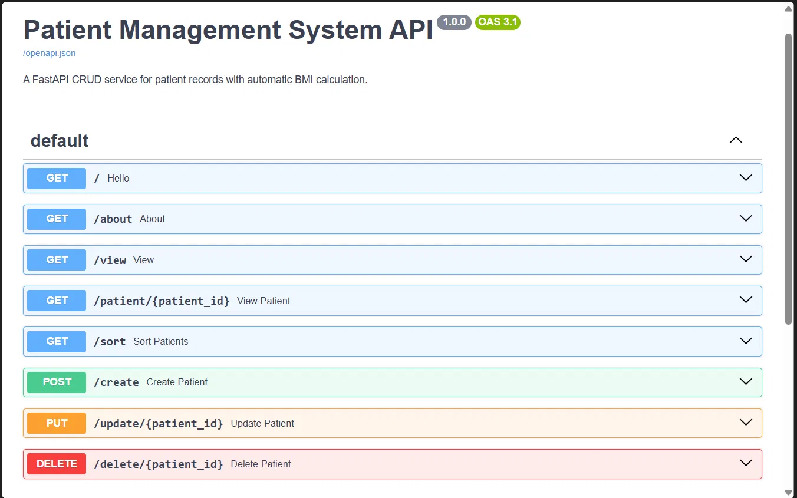

# 🏥 Patient Management System API


A RESTful API built with **FastAPI** to manage patient records. It supports full CRUD operations, strict data validation with **Pydantic v2**, automatic **BMI and health verdict calculation**, and sorting patients by health metrics. Interactive API documentation is generated automatically with Swagger UI.

> Built as a hands-on project to practice backend API design, data validation, and error handling in FastAPI.

---

## 📸 Preview



*Interactive API docs available at `/docs` once the server is running.*

---

## ✨ Features

- **Full CRUD**: create, read, update and delete patient records
- **Automatic BMI calculation**: `bmi` and `verdict` are computed fields, derived from height and weight, so they can never be out of sync
- **Partial updates**: the `PUT` endpoint only changes the fields you send, and recalculates BMI afterwards
- **Strong validation**: Pydantic models enforce types, ranges (for example `0 < age < 100`) and allowed values
- **Case-insensitive gender input**: `male`, `MALE` and `Male` are all accepted and stored consistently
- **Sorting**: sort patients by `height`, `weight` or `bmi` in ascending or descending order
- **Clear error handling**: proper HTTP status codes (`201`, `400`, `404`, `422`) with helpful messages
- **Auto-generated docs**: Swagger UI (`/docs`) and ReDoc (`/redoc`)

---

## 🛠️ Tech Stack

| Layer | Technology |
|---|---|
| Language | Python 3.10+ |
| Framework | FastAPI |
| Validation | Pydantic v2 |
| Server | Uvicorn (ASGI) |
| Storage | JSON file (`patients.json`) |

---

## 🚀 Getting Started

### 1. Clone the repository

```bash
git clone https://github.com/yashhyadav/patient-management-system-fastapi.git
cd patient-management-system-fastapi
```

### 2. Create and activate a virtual environment

```bash
# Windows
python -m venv myenv
myenv\Scripts\activate

# macOS / Linux
python3 -m venv myenv
source myenv/bin/activate
```

### 3. Install dependencies

```bash
pip install -r requirements.txt
```

### 4. Run the server

```bash
uvicorn main:app --reload
```

The API is now running at **http://127.0.0.1:8000**

- Swagger UI: http://127.0.0.1:8000/docs
- ReDoc: http://127.0.0.1:8000/redoc

---

## 📡 API Endpoints

| Method | Endpoint | Description |
|---|---|---|
| `GET` | `/` | Welcome message |
| `GET` | `/about` | About the API |
| `GET` | `/view` | Get all patients |
| `GET` | `/patient/{patient_id}` | Get a single patient by ID |
| `GET` | `/sort?sort_by=bmi&order=desc` | Sort patients by `height`, `weight` or `bmi` |
| `POST` | `/create` | Create a new patient |
| `PUT` | `/update/{patient_id}` | Update one or more fields of a patient |
| `DELETE` | `/delete/{patient_id}` | Delete a patient |

---

## 🧪 Example Requests

### Create a patient

`POST /create`

```json
{
  "id": "P006",
  "name": "Rahul Singh",
  "city": "Delhi",
  "age": 29,
  "gender": "Male",
  "height": 175,
  "weight": 72
}
```

**Response** `201 Created`

```json
{ "message": "Patient created successfully" }
```

The stored record will include the computed fields:

```json
{
  "name": "Rahul Singh",
  "city": "Delhi",
  "age": 29,
  "gender": "Male",
  "height": 175.0,
  "weight": 72.0,
  "bmi": 23.51,
  "verdict": "Normal weight"
}
```

### Update a patient (partial update)

`PUT /update/P006`

```json
{
  "city": "Mumbai",
  "weight": 80
}
```

Only `city` and `weight` change, and `bmi` and `verdict` are recalculated automatically.

### Sort patients by BMI (highest first)

```
GET /sort?sort_by=bmi&order=desc
```

### Error example

`GET /patient/P999`

```json
{ "detail": "Patient not found" }
```

---

## 📏 Data Model & Validation

| Field | Type | Rules |
|---|---|---|
| `id` | string | Required, unique (for example `P001`) |
| `name` | string | Required |
| `city` | string | Required |
| `age` | integer | Required, `0 < age < 100` |
| `gender` | string | `Male`, `Female` or `others` (case-insensitive input) |
| `height` | float | Required, in **cm**, must be `> 0` |
| `weight` | float | Required, in **kg**, must be `> 0` |
| `bmi` | float | *Computed* as `weight / (height/100)²` |
| `verdict` | string | *Computed* from BMI (see below) |

### BMI Verdict

| BMI | Verdict |
|---|---|
| < 18.5 | Underweight |
| 18.5 – 24.9 | Normal weight |
| 25 – 29.9 | Overweight |
| ≥ 30 | Obese |

---

## 📁 Project Structure

```
patient-management-system-fastapi/
├── main.py            # FastAPI app, models and routes
├── patients.json      # Sample patient data (acts as the database)
├── requirements.txt   # Python dependencies
├── docs/
│   └── swagger.png    # Screenshot of the API docs
├── .gitignore
└── README.md
```

---

## 🧠 What I Learned

- Designing REST endpoints with the correct HTTP methods and status codes
- Using **Pydantic v2** features: `Field` constraints, `computed_field`, `field_validator`, and `model_dump(exclude_unset=True)` for partial updates
- Re-validating merged data so derived values (BMI) stay accurate
- Handling errors cleanly with `HTTPException`
- Debugging real server errors (500 vs 422) using tracebacks

---

## 🔮 Future Improvements

- [ ] Replace JSON file storage with **SQLite / PostgreSQL** using SQLAlchemy
- [ ] Add **authentication** (JWT) for healthcare staff
- [ ] Write automated tests with `pytest` and `TestClient`
- [ ] Add pagination and search/filter endpoints
- [ ] **Dockerize** the application
- [ ] Deploy to Render / Railway and add a live demo link

---

## 🤝 Contributing

Suggestions and improvements are welcome. Fork the repo, create a branch, and open a pull request.

---

## 📄 License

This project is licensed under the MIT License.

---

## 👤 Author

**Yash Yadav**

- GitHub: [@yashhyadav](https://github.com/yashhyadav)

⭐ If you found this project useful, consider giving it a star!
